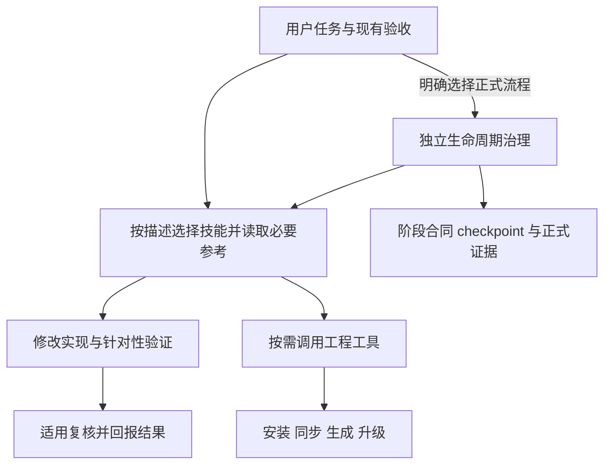

# 借鉴 Matt Skills v1.3.1，移除默认流程门禁的调研与重构建议

日期：2026-10-23。状态：调研结论与待实施建议，不是现行政策，也不继承历史会话的批准。

## 结论

可以借鉴，而且值得做。应借鉴“独立技能、描述驱动发现、按任务加载、复用现有 Issue/Spec、围绕实际反馈推进”的架构。建议让普通开发直接使用技能，将生命周期审批、注册表资格和 checkpoint 从默认执行路径移出；正式治理保留为明确选用的独立能力。

这次应做流程减法。昨天的 Matt 优化方案选择保留治理体系，重点修复发布、诊断、指标与观察；本次建议改变默认工作方式，目标不同。继续在旧路由之上补一层“更轻模式”，容易让 daily/standard/governed 再增加分支。

“减少验证”应具体落实为：不再为了使用技能先证明流程资格，不要求人工维护多份证据和状态，不执行与改动无关的检查；实现是否满足验收仍用真实测试、编译及适用复核判断。本文没有测量耗时或 Token 收益，不承诺百分比提升。

## 1. 比较范围与可复核基线

| 对象 | 固定基线 | 使用方式 |
|---|---|---|
| mattpocock/skills | v1.3.1，commit `24fe0ef7737efae15c87225755e9f6f5965e4888` | 只比较该版本源码，不混用 main |
| 模板仓 main | `9988c1d1e2fae0f868c6dfb32ae7c7119011ee7e` | 分析 Spec canonical、Backend 分发入口与共享政策 |
| CLI 仓 main | `7b92c7784ec553cee253b34a78e19088b9a22cce` | 分析技能发现、daily 和治理加载耦合 |
| CLI 实际固定模板 | `a435d0693b374e58f803b61817c9d8f9402c72e9`，v4.7.1 | 来自 `docs/source-lock.json`；不能把当前模板 main 当成已装配 Bundle |
| 本地 Matt 来源锁 | `0ab1b63a410a03d3627979a109c8695de27af954` | 来自模板 `skills-lock.json`；有本地适配，不能声称已经整体升级到 v1.3.1 |

用户文字中的“注册注册机”暂按“注册表、注册机制及流程状态机”理解。没有将其解释为许可证或第三方访问控制。当前两仓工作区初始无未提交改动。本次只增加调研文档，不修改程序、技能、锁、CI、用户实例和历史状态。

本地证据均链接到上述固定提交。上游证据见文末附录。GitHub connector 读取成功；执行器 shell 的外网代理读取失败，没有关闭代理或改用不验证 TLS 的方式。

## 2. 上游模式与本项目的差异

| 维度 | Matt v1.3.1 | 本项目 | 建议借鉴方式 |
|---|---|---|---|
| 发现 | 扫描 SKILL.md；描述和 user/model 调用规则 | 目录之外叠加注册表、分发锁和运行时就绪解析 | 本地发现独立，受管安装另验 |
| 普通实现 | implement 直接消费用户 spec/tickets | implement 回到生命周期核验 Slice 和门禁 | 删除普通技能的治理先决条件 |
| 配置依赖 | ADR 区分硬/软依赖；缺词汇资料可继续 | 身份、政策和证据格式进入普通路由前置 | 仅实际必需数据缺失时停止相关操作 |
| 跨技能协作 | 显式调用所需技能，router 提供路线图 | 编排政策、typed dependency、task-package 等共同决定 | 主线技能负责推进，参考资料按需读 |
| 检查 | 代码检查和 review；拒绝独立 setup verify 模式 | 包含工程检查，也验证多类治理协议 | 删重复流程协议，保留工程验证 |
| 发布 | 分发清单和版本同步检查仍存在 | 固定 Bundle、来源摘要、原生证据及兼容协议 | 在分发边界检查，默认任务不承担发行资格流程 |

依据为附录中的固定源码。需要特别纠正：Matt 的 implement 本体没有 setup 前提，但它调用的 code-review 仍要求 tracker 配置，因此上游整条组合路径并非完全无 setup；借鉴时应明确去掉本项目普通审查对 tracker 的不必要依赖，而非声称照搬即可解决全部问题。

## 3. 当前项目已经简化了什么

1. **普通任务已存在免 checkpoint 路径。** `request_triage.delivery_path` 声明 daily 不建正式阶段包；有目标、范围、验收、基线等条件。问题是这条路径仍需证明资格并填写结构化证据。[模板政策](https://github.com/iloveZzz/yss-spec-project-template/blob/9988c1d1e2fae0f868c6dfb32ae7c7119011ee7e/.template-spec/process/orchestration/entry/request-triage.yaml#L9)
2. **人员/数字人资质注册已经退出新政策。** `qualification_registry: forbidden`、`qualification_registration: forbidden`，默认单执行者；把“取消人员注册”再列为新增交付会重复建设。[Profile 政策](https://github.com/iloveZzz/yss-spec-project-template/blob/9988c1d1e2fae0f868c6dfb32ae7c7119011ee7e/.template-spec/process/orchestration/entry/profile-policy.yaml#L69)
3. **默认复核已经是 self-check。** 明确用户要求或已知外部规则才需要独立复核，检查轴不等于人数。[复核政策](https://github.com/iloveZzz/yss-spec-project-template/blob/9988c1d1e2fae0f868c6dfb32ae7c7119011ee7e/.template-spec/process/orchestration/entry/profile-policy.yaml#L21)
4. **Spec 正式门禁已经合并为四阶段。** 技术/API/接入不再各自人工批准；但仍维护阶段成果、检查证据、用户决定、checkpoint 引用及当前性。[四阶段门禁](https://github.com/iloveZzz/yss-spec-project-template/blob/9988c1d1e2fae0f868c6dfb32ae7c7119011ee7e/.template-spec/process/stage-gates.md#L1)
5. **按影响选择检查已经有合同。** 模板维护允许必要检查通过就结束，不默认全量；新重构应解决实际入口及依赖，而非再重复写一次原则。[维护技能](https://github.com/iloveZzz/yss-spec-project-template/blob/9988c1d1e2fae0f868c6dfb32ae7c7119011ee7e/.agents/skills/maintaining-skills/SKILL.md#L15)

昨日方案明确选择“保留 YSS 已有治理与证据能力”，C3/C4 是未来设计，不能把它们当成已实现的去门禁方案。[原设计](https://github.com/iloveZzz/yss-spec-project-template/blob/9988c1d1e2fae0f868c6dfb32ae7c7119011ee7e/.template-source/contracts/2026-10-22-matt-method-optimization-design.md#L43)

## 4. 当前复杂度的真正来源

### 4.1 普通任务的启动依赖过多

`daily.run` 在实现前读取身份、政策、工程根、Git 基线、CONTEXT/AGENTS、唯一 Markdown JSON evidence block、目标/验收引用、工程/回滚引用、写范围/风险、impacts、技能/输入摘要及命令。`readPolicy` 还精确匹配一组受支持字段集合。使用技能之前已经承担一套协议成本。[daily.go](https://github.com/iloveZzz/yss-cli/blob/7b92c7784ec553cee253b34a78e19088b9a22cce/internal/governance/lifecycle/daily.go#L137)

因此不能将“daily 不生成 checkpoint”推导成“daily 已经像 Matt 一样轻”。对行为变化或新能力，standard 另要求 Spec-lite 和绑定摘要的真实用户决定；一般的实现授权还要转成内部数据才能被消费。[standard 实现](https://github.com/iloveZzz/yss-cli/blob/7b92c7784ec553cee253b34a78e19088b9a22cce/internal/governance/lifecycle/daily_standard.go#L9)

### 4.2 技能发现与治理资格混在一起

761 行技能注册表同时记录身份、capability、平台、架构、调用模式与类型化依赖。790 行 Node 校验模块的默认校验还加载 lock、后端平台、实现编译合同、生命周期合同并扫描脚本。它有分发价值，但不适合成为每个技能能否工作的先决条件。[注册表](https://github.com/iloveZzz/yss-spec-project-template/blob/9988c1d1e2fae0f868c6dfb32ae7c7119011ee7e/.template-spec/agents/yss-skill-registry.yaml#L1)、[校验入口](https://github.com/iloveZzz/yss-spec-project-template/blob/9988c1d1e2fae0f868c6dfb32ae7c7119011ee7e/scripts/lib/skill-registry.mjs#L770)

CLI `skills resolve` 当前从固定 Bundle 注册表、lock 与受管安装状态解析内置技能，并核验选中闭包；未知及非内置技能拒绝解析。这是受管分发解析器，并非通用本地技能发现器。`list --details` 已有 metadata-only 轻查询，不能笼统声称每次列技能都哈希全树。[查询实现](https://github.com/iloveZzz/yss-cli/blob/7b92c7784ec553cee253b34a78e19088b9a22cce/internal/project/skills_query.go#L93)、[resolve](https://github.com/iloveZzz/yss-cli/blob/7b92c7784ec553cee253b34a78e19088b9a22cce/internal/project/skills_query.go#L265)

### 4.3 即便轻量入口仍可能穿过完整治理内核

schema v2 project-instance 的 daily 身份读取调用 `Authorities()`；其加载生命周期注册表、Profile 和治理政策，随后进行 schema 与稳定 ID 校验。治理上下文不是天然按需求最小加载。[daily 身份](https://github.com/iloveZzz/yss-cli/blob/7b92c7784ec553cee253b34a78e19088b9a22cce/internal/governance/lifecycle/daily.go#L414)、[Authorities 加载](https://github.com/iloveZzz/yss-cli/blob/7b92c7784ec553cee253b34a78e19088b9a22cce/internal/governance/kernel/semantic_core.go#L977)

### 4.4 本地适配将上游方法重新包进了流程资格

本地 `implement` 首段要求回生命周期编排器核验身份、实现路径、已批准 Slice 和门禁。本地 `code-review` 虽可用同一 Ticket，但 daily 仍先取资格；governed 仍消费编译输入与候选证据。因此只更新上游文字，入口依赖仍在。[implement](https://github.com/iloveZzz/yss-spec-project-template/blob/9988c1d1e2fae0f868c6dfb32ae7c7119011ee7e/.agents/skills/implement/SKILL.md#L7)、[code-review](https://github.com/iloveZzz/yss-spec-project-template/blob/9988c1d1e2fae0f868c6dfb32ae7c7119011ee7e/.agents/skills/code-review/SKILL.md#L18)

### 4.5 checkpoint 实际是三种东西

| 类型 | 当前用途 | 建议 |
|---|---|---|
| 生命周期 checkpoint | 阶段状态、成果版本和批准引用 | 退出默认任务；正式治理模块内保留 |
| 模板维护 checkpoint | 强度、状态、复核及证据协议 | 普通维护改用同一 PR/任务的简短记录，不要求补协议文件 |
| Git `refs/checkpoints/*` | 用临时 index 保存工作树快照，不移动 HEAD | 改为显式可选快照工具；与阶段放行解耦 |

第三种由 `checkpoint-commit.mjs` 实现，含路径/ref 校验并拒绝覆盖。它不是审批状态机，直接全局搜索删除会损失有用的本地快照功能。[Git 快照](https://github.com/iloveZzz/yss-spec-project-template/blob/9988c1d1e2fae0f868c6dfb32ae7c7119011ee7e/scripts/lib/checkpoint-commit.mjs#L26)

### 4.6 静态规模只说明维护面，不证明性能

在模板固定 HEAD 对以下目录递归统计实际文件（包含引用资源，非全是运行时必读内容）：`.agents/skills` 987 个文件、194581 行；`scripts/lib` 149 个文件、20556 行；`tests` 136 个文件、39636 行；process schemas 59 个文件、24812 行。CLI `internal/governance` 非测试 Go 文件 124 个、42153 行。技能注册表 761 行，生命周期注册表 591 行。

这说明应从依赖边界着手，而不能直接用行数推断执行慢、决策差或应全部删除。没有进行线上实例回放、模型效果对比或耗时基准。

## 5. 推荐架构：独立技能 + 工程工具 + 可选治理

普通路径不加载 `lifecycle-registry.yaml`、阶段 checkpoint、角色表或 task-package，不要求先 route 才能读技能或开始已授权实现。默认技能入口本身可独立使用；调用者只提供当前任务实际需要的信息。多阶段产品决策仍可用澄清、Spec、Ticket、实现等方法组织，但不强制在每步生成批准文件。

工程工具拥有文件写入、受管分发和外部动作的明确边界。安装/同步/升级时验证来源与目标，开始普通任务时不重复完整安装验收。使用过程中若选中技能入口缺失或无法读取，只处理该技能；已有证据表明目录被修改时按当前文件使用规则处理，不能拿历史校验结果冒充当前受管完整性。

可选治理仅在明确选用时加载；现有正式实例保持原有语义，直到明确迁移。不能把旧 approved 字段原地改成新轻量任务的完成状态。新建轻量项目无需创建治理资产来证明“无需治理”。

### 备选方案比较

| 方案 | 优点 | 代价 | 判断 |
|---|---|---|---|
| 在现有路由里继续放宽 daily/standard | 改动小 | 仍先读治理政策，协议与分支持续增长 | 仅适合短期补丁 |
| 独立技能与可选治理分离 | 默认成本下降，保留专业知识与历史兼容 | 需调整入口、分发和 CLI 加载边界 | 推荐 |
| 完全复制 Matt 并删除全部治理代码 | 最接近上游 | 丢失领域能力和现有实例协议；Matt 也有交互暂停点 | 不建议整体替换 |

不新增第四条 `lite` 路线；新默认入口直接工作。旧 daily/standard/governed 作为已有协议兼容入口，不继续扩展成默认调度框架。未来可以退役旧协议，但需先查明真实使用情况与受支持版本，本文未假定已经没有消费者。

## 6. 删除、降级、保留清单

| 对象 | 默认技能路径的处理 | 仍适用的范围 |
|---|---|---|
| 开始任务必须 `lifecycle route` | 移除 | 显式治理查询保持旧语义 |
| 日常单 Markdown 必须嵌唯一 JSON evidence block | 移除 | 旧 daily verifier 兼容读取，不伪造成功 |
| 默认 checkpoint、阶段批准、Slice 合同 | 移除前提 | 明确选择正式治理的实例 |
| 仅因增加能力就转 standard 并重新保存决定摘要 | 普通任务移除 | 存在实际新范围或真实决策缺口时再沟通 |
| 人员/数字人资质注册 | 已禁止，清理仍可达旧指引 | 冻结历史只读核验 |
| 手工维护全局技能路由表 | 改为从 SKILL frontmatter 生成发现索引 | 别名、分发来源与投影配置保留必要元数据 |
| 每次使用核验技能锁/投影 | 从默认调用链移出 | 安装、同步、升级、显式 doctor 或发现具体漂移时 |
| 每个维护任务的强度/候选/回执套件 | 默认移除 | 候选和发布工具按各自真实输入运行 |
| 完整注册表/锁检查 | 不作为每个局部修改的固定成本 | 相关源变化及分发集成/发行时执行 |
| 测试、编译、格式与实际验收 | 按改动影响保留 | 工程质量判断 |
| 路径边界、覆盖冲突、事务恢复、包完整性 | 在实际写入边界保留 | 安装/生成/升级/恢复 |
| 提交/推送/发布/部署授权 | 复用会话有效授权，不要求用户填写内部字段 | 实际执行相应动作时 |

保留检查应有一个具体错误模型：越界写入、覆盖用户文件、损坏安装包、未完成事务被再次写入、验收失败。仅因“字段未登记、流程形状不匹配、旧模板缺辅助文件”就阻止普通技能工作，不应是新默认路径的设计目标。

## 7. 建议实施顺序与验收

### 第一批：先让核心技能独立

范围：模板 `AGENTS.md`、`agent-entry-policy.md`、canonical `implement`/`code-review`/研究及实际引用它们的入口；Spec 与 Backend 同步核对。创建技能即执行通用技能维护约定，按现有生成器更新受影响投影和锁，不手改派生副本。

验收：在只有正常工程、用户需求和已安装技能的目录中，能启动实现和审查；缺 lifecycle registry、checkpoint、角色表、tracker setup、正式 Slice 不阻断。没有 Spec 时如实指出无法评估该轴，不补空 Spec，不伪造验证通过。专业技能自己的必需输入仍按实际任务取得。

### 第二批：拆开技能发现与受管安装验证

范围：生成发现索引；CLI `internal/project/skills_query.go` 与必要分发消费者。普通发现读取 SKILL 的 name/description 和入口，不调用 `Authorities()`。安装/同步继续用现有事务与来源校验。

验收：能发现合法本地技能；无关技能错误不阻断选中技能。安装动作仍拒绝越界、覆盖冲突和包损坏。现有 `resolve` 的 ready/missing/blocked 不悄悄改义；若增加新的轻发现能力，在评审中明确接口与输出，不把建议命令当成已经存在。

### 第三批：让 checkpoint 和治理模块变成按需加载

范围：生命周期内核加载边界、旧 Node 薄壳、维护快照调用链、阶段工具。先从默认依赖图移除，再按实际消费者逐步退役。

验收：普通实现不进入治理内核；显式正式命令仍按原政策判断。`refs/checkpoints` 只在主动请求快照时创建。旧记录可以只读解释；不自动迁移或删除用户实例。没有检查通过时，旧 verifier 仍不得返回通过。

### 第四批：减少维护 CI 的重复固定检查

`ci-gate.mjs` 当前固定列有 sync-skills、skill-lock、lifecycle-registry、skill-registry 等，再执行受影响 fast 检查；是否在同一次运行里真实重复执行，需读取计划或运行日志证明，本文只确认静态接线，未测算重复耗时。

范围：把分发/注册表检查放到相应输入变化及集成/发行边界；复用现有 fast 影响选择器，不新建另一套测试注册系统。[当前步骤](https://github.com/iloveZzz/yss-spec-project-template/blob/9988c1d1e2fae0f868c6dfb32ae7c7119011ee7e/scripts/lib/ci-gate.mjs#L28)

验收：纯说明修改不遍历无关治理体系；注册元数据和生成逻辑变化能触发对应检查；普通维护不生成产品资产。实际执行范围及未覆盖项如实报告。

### 第五批：分发收口与兼容代码退役

模板事实源与消费者完成后，再更新 CLI 固定 Bundle 和来源锁。使用新建轻量项目与现有正式项目两类用例分别验证。只在声明支持的兼容窗口结束且真实消费者清点后删除遗留实现，不为一次重构同时强迫所有用户项目迁移。

行为变更复用有代表性的现有测试，补“缺治理文件也能使用核心技能”这一新边界及安装写入拒绝反例。Go 行为修改按 CLI AGENTS 跑要求的测试与构建；文档研究阶段不启动这些程序验收。不写只验证文案包含某词的测试。

## 8. 收益如何判定

固定同类真实任务、相同工具与环境，记录：首次实现前所需的文件读取与命令、额外生成文件、重复索取已有授权、无关阻断、验证执行/等待时间，以及真实缺陷与返工。来自当前对话的重复确认可以定位到原消息；缺完整记录则记 unknown。

建议的架构验收指标：普通任务强制新增治理文件为 0，强制 checkpoint 为 0，强制人员注册为 0，选技能无需完整生命周期校验。它们是待实施目标，不是现状或已测收益。测试应能捕获真实行为错误；减少检查数量本身不算成功。

## 9. 本次交付与限制

本次完成固定版本源码比较、本项目入口/消费者静态分析、删改分类和分批重构建议。没有修改产品行为、删除现有检查、刷新 Bundle、提交、推送或发布。未运行产品测试，也未获得真实性能对比数据。

后续若进入架构实施，需先确认新默认行为和兼容边界；不能将昨天另一方案中的“已批准”沿用到本次去门禁重构。当前使用的 brainstorming 技能要求架构实现前审阅设计及实施计划；它不要求本次研究创建产品 checkpoint 或批准记录。

## 附录：上游一手证据与反向信号

调研日期：2026-10-23。范围：固定版本上游源码；未修改 YSS 两个仓库，未执行上游流程或安装脚本。

### 版本事实

- 存在真实 annotated tag `v1.3.1`，tag 对象为 `0b6cee10f260a2e048279cf737bfd3e37b1fce0b`，解引用后 commit 为 `24fe0ef7737efae15c87225755e9f6f5965e4888`。[Git tag API](https://api.github.com/repos/mattpocock/skills/git/tags/0b6cee10f260a2e048279cf737bfd3e37b1fce0b)
- GitHub Release 于 2026-10-04 发布，非 draft、非 prerelease。[Release](https://github.com/mattpocock/skills/releases/tag/v1.3.1)
- package 与 plugin 均声明 1.3.1：[package.json](https://github.com/mattpocock/skills/blob/24fe0ef7737efae15c87225755e9f6f5965e4888/package.json#L1-L15)、[.claude-plugin/plugin.json](https://github.com/mattpocock/skills/blob/24fe0ef7737efae15c87225755e9f6f5965e4888/.claude-plugin/plugin.json#L1-L4)。
- main 已前进到 `5beb35b040e3de97e54fa9e386d7e42d15c295c2`（2026-10-19），本报告不把 main 新行为混入 1.3.1。

### 最值得借鉴的模式：不将所有资料升级成执行资格

1. **硬依赖与软依赖明确分开。** ADR 只对会写错目标系统/标签的技能强制 setup；领域词汇与 ADR 缺失时，部分技能可降级继续。[.agents/adr/0001-explicit-setup-pointer-only-for-hard-dependencies.md](https://github.com/mattpocock/skills/blob/24fe0ef7737efae15c87225755e9f6f5965e4888/.agents/adr/0001-explicit-setup-pointer-only-for-hard-dependencies.md#L3-L10)。注意该 ADR 的清单并不完整：实际 code-review 和 implement-spec 也写有 setup 前提，必须以消费者实际文本为准。
2. **普通实现非常薄。** implement 只有使用 TDD、定期 typecheck/单测、最后全测、code-review、commit 六类指令，没有产品身份、注册表、checkpoint、阶段批准前提。[skills/engineering/implement/SKILL.md](https://github.com/mattpocock/skills/blob/24fe0ef7737efae15c87225755e9f6f5965e4888/skills/engineering/implement/SKILL.md#L1-L16)。其中自动 commit 指令不适合直接照搬 YSS 的提交授权约定。
3. **拒绝增加独立 setup verify/check 模式。** 理由是自然语言入口已经能做现有配置漂移检查，另加 flag/skill 会重复表面并导致种子模板漂移。[.out-of-scope/setup-skill-verify-mode.md](https://github.com/mattpocock/skills/blob/24fe0ef7737efae15c87225755e9f6f5965e4888/.out-of-scope/setup-skill-verify-mode.md#L3-L11)。这支持删掉重复“配置是否合法”的仪式，不支持取消真正的代码行为验证。
4. **路由是地图。** ask-matt 为人解释情境、主线和分叉；单会话可直接 implement，多会话才 spec/tickets，巨大模糊任务才 wayfinder。[skills/engineering/ask-matt/SKILL.md](https://github.com/mattpocock/skills/blob/24fe0ef7737efae15c87225755e9f6f5965e4888/skills/engineering/ask-matt/SKILL.md#L11-L32)、[skills/engineering/ask-matt/SKILL.md](https://github.com/mattpocock/skills/blob/24fe0ef7737efae15c87225755e9f6f5965e4888/skills/engineering/ask-matt/SKILL.md#L44-L56)。
5. **按需加载和所有权。** 跨技能依赖显式调用 Skill tool；共享参考归拥有它的技能，避免多份规范；单纯读 glossary 不必调用完整 domain-modeling 流程。[.agents/invocation.md](https://github.com/mattpocock/skills/blob/24fe0ef7737efae15c87225755e9f6f5965e4888/.agents/invocation.md#L14-L26)。
6. **机械约束交给便宜的确定性工具。** retro 明确建议 lint/CI/pre-commit，判断性要求交给 review，AGENTS 尽量只做导航。[skills/engineering/retro/SKILL.md](https://github.com/mattpocock/skills/blob/24fe0ef7737efae15c87225755e9f6f5965e4888/skills/engineering/retro/SKILL.md#L17-L22)、[skills/engineering/retro/SKILL.md](https://github.com/mattpocock/skills/blob/24fe0ef7737efae15c87225755e9f6f5965e4888/skills/engineering/retro/SKILL.md#L39-L44)。

### 不是“完全无门禁”：真实暂停点

| 入口 | 真正前提/暂停点 | 不能误读为 |
| --- | --- | --- |
| setup | 先探索，再逐节询问；展示配置草案并让人修改后写入；没有现存入口文件时询问创建哪一个 | 零确认、自动注册 |
| implement | 本体无 setup/身份/checkpoint 前提；仍要求代码检查与 review | 不测试、不评审 |
| implement-spec | 需要 spec/tickets 和 issue-tracker 配置；缺配置提示用户运行 setup；按 ticket blockers 工作；确认 worktree 基于集成分支；结束 review | 无依赖、无 Git 校验 |
| code-review | 缺 tracker 配置提示 setup；未提供基点则询问；基点不存在或 diff 空提前失败；找不到 spec 询问，无 spec 可跳过 Spec 轴 | 所有资料缺失都继续、或必须补造 spec |
| to-spec | 缺 tracker 配置提示 setup；测试 seams 向用户核对 | 纯自动规格生成 |
| to-tickets | 缺 tracker 配置提示 setup；拆解和阻塞边由用户批准后才发布 | 无批准的外部写入 |
| pr | 仅定义 PR 正文形状，Evidence 的 before/after 与 Merge Danger；没有注册、checkpoint、证据 schema 校验、审批状态机 | 可以虚构成功结果 |

来源：setup [skills/engineering/setup-matt-pocock-skills/SKILL.md](https://github.com/mattpocock/skills/blob/24fe0ef7737efae15c87225755e9f6f5965e4888/skills/engineering/setup-matt-pocock-skills/SKILL.md#L15-L80)；implement-spec [skills/engineering/implement-spec/SKILL.md](https://github.com/mattpocock/skills/blob/24fe0ef7737efae15c87225755e9f6f5965e4888/skills/engineering/implement-spec/SKILL.md#L7-L40)；code-review [skills/engineering/code-review/SKILL.md](https://github.com/mattpocock/skills/blob/24fe0ef7737efae15c87225755e9f6f5965e4888/skills/engineering/code-review/SKILL.md#L13-L32)；to-spec [skills/engineering/to-spec/SKILL.md](https://github.com/mattpocock/skills/blob/24fe0ef7737efae15c87225755e9f6f5965e4888/skills/engineering/to-spec/SKILL.md#L9-L21)；to-tickets [skills/engineering/to-tickets/SKILL.md](https://github.com/mattpocock/skills/blob/24fe0ef7737efae15c87225755e9f6f5965e4888/skills/engineering/to-tickets/SKILL.md#L40-L74)；pr [skills/engineering/pr/SKILL.md](https://github.com/mattpocock/skills/blob/24fe0ef7737efae15c87225755e9f6f5965e4888/skills/engineering/pr/SKILL.md#L12-L33)。

### 注册表与 checkpoint 的准确结论

通过 [固定 SHA 完整递归 tree](https://api.github.com/repos/mattpocock/skills/git/trees/24fe0ef7737efae15c87225755e9f6f5965e4888?recursive=1) 及关键消费者源码：

- 未见 YSS 式全局生命周期 registry、角色/阶段/批准 registry、checkpoint 状态资产、checkpoint 编译器/验证脚本、阶段资格查询器。
- **仍有分发清单**：plugin.json 的 skills 数组；AGENTS 要求正式桶与 README、插件清单同步。因此不能笼统说“没有注册表”。这里清单负责分发，不负责授予实现资格。[AGENTS.md](https://github.com/mattpocock/skills/blob/24fe0ef7737efae15c87225755e9f6f5965e4888/AGENTS.md#L1-L21)。
- 本地列举技能直接 find SKILL.md，没有先读取独立技能注册 schema：[scripts/list-skills.sh](https://github.com/mattpocock/skills/blob/24fe0ef7737efae15c87225755e9f6f5965e4888/scripts/list-skills.sh#L1-L8)。开发链接脚本也扫描目录，跳过 misc/deprecated，保留 in-progress；它是明确不支持的维护者工具，且包含 rm -rf，不适合照搬。[scripts/link-skills.sh](https://github.com/mattpocock/skills/blob/24fe0ef7737efae15c87225755e9f6f5965e4888/scripts/link-skills.sh#L4-L8)、[scripts/link-skills.sh](https://github.com/mattpocock/skills/blob/24fe0ef7737efae15c87225755e9f6f5965e4888/scripts/link-skills.sh#L17-L33)、[scripts/link-skills.sh](https://github.com/mattpocock/skills/blob/24fe0ef7737efae15c87225755e9f6f5965e4888/scripts/link-skills.sh#L55-L67)。
- 人工/模型可调用是唯一主要调用维度。user-invoked 只有人能启动，router 只提示不能代调；这是上游有意保留的权限边界。[.agents/invocation.md](https://github.com/mattpocock/skills/blob/24fe0ef7737efae15c87225755e9f6f5965e4888/.agents/invocation.md#L3-L12)、[skills/productivity/writing-for-agents/SKILL-MECHANICS.md](https://github.com/mattpocock/skills/blob/24fe0ef7737efae15c87225755e9f6f5965e4888/skills/productivity/writing-for-agents/SKILL-MECHANICS.md#L20-L22)。
- 上游存在 manifest strict validation、版本同步 check 和 Changesets 发布流程。轻量是缩小校验范围，不是删掉所有校验：[AGENTS.md](https://github.com/mattpocock/skills/blob/24fe0ef7737efae15c87225755e9f6f5965e4888/AGENTS.md#L9-L11)、[package.json](https://github.com/mattpocock/skills/blob/24fe0ef7737efae15c87225755e9f6f5965e4888/package.json#L11-L15)、[.github/workflows/release.yml](https://github.com/mattpocock/skills/blob/24fe0ef7737efae15c87225755e9f6f5965e4888/.github/workflows/release.yml#L19-L38)。

### 对本次 YSS 新方向的启发

若目标由“保留门禁，优化使用”改为“移除流程前提”，借鉴点应落到依赖关系上：

- 日常技能直接从用户目标/任务上下文进入；缺 glossary、ADR、流程登记时不阻止实现。
- 删除 registry/checkpoint 的执行资格作用，普通任务不必写新的机器状态资产；真实变更、验收与实际验证放回单一 Ticket/PR/会话记录。
- 保留一个小的分发清单或直接目录发现；无需把技能存在、调用合法、阶段资格连成一套注册系统。
- 只在真正需要目标地址/平台身份的外部写入处索取缺失信息；不要因为做本地分析或代码修改而要求先 setup 完整个仓库。
- 验证集中在代码行为、构建、输入输出和安装包完整性；删除仅证明“流程记录满足流程 schema”的验证，同时删除消费者与失效接口，而非仅让 validator 永远返回成功。
- 不机械复制上游 user-only 的大量入口限制、setup 草案确认、自动 commit、重置 worktree 等指令；这些与本用户持续授权、保护工作区的要求需分别处理。

本地取证副本在 `/tmp/matt-skills-v1.3.1/`，仅含本报告引用的关键源码；完整目录发现来自 GitHub recursive tree。Shell git 因环境代理连不上而失败，后续证据全部由 GitHub connector 取得。

