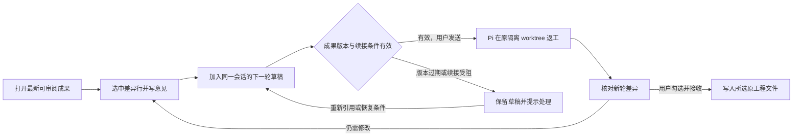

# Pi Agent 会话执行与成果审阅方案

2026-11-25 · 评审草稿 · [主规格与验收](2026-11-25-pi-agent-workspace-spec.md) · [当前原型](../../../prototypes/2026-11-25-pi-agent-workspace/dist/index.html)

工作台用户需要从会话列表判断哪项工作等他处理，在对话中找到执行证据，并把审阅意见准确交给 Pi。首版建议补齐**待处理会话、执行活动分组、差异行返工**。下一批在同一会话加入**可编辑的下一轮队列**。页面沿用按参考图调整的现有布局，左栏组织会话，中央承载对话与执行活动，右侧进入成果审阅，底部提交本轮要求。

依据为 T3 Code 稳定版 `v0.1.11` 和 YSS CLI 3.17.1 源码 `13374bb`。YSS 已具备按 Spec 发起、同会话续接、结构化业务提问、隔离 worktree 及三方差异接收。本文细化主 Spec 草稿的交互与验收。页面顶部的原型链接指向现有模拟场景，可操作发起、续接、答复、成果查看和冲突复核。待处理筛选、跨轮活动分组、差异选行返工和队列属于后续原型验证。 [T3 Code 发布记录](https://github.com/pingdotgg/t3code/releases/tag/v0.1.11) · [YSS 运行说明](../../workbench.md#在工作台运行-pi-agent)

## 1. 功能取舍

| 交付顺序 | 借鉴点 | YSS 的设计范围 |
| --- | --- | --- |
| 首版 · 待处理会话 | 线程待回答、失败或结束时回到容易看到的位置，折叠分组也提示需处理事项。 | 沿已有 Spec 分组显示待答复、失败、待审阅。保留正常历史顺序，使用「待处理」筛选定位相关会话和轮次。细化 FR-01、FR-03、FR-04。 [T3 线程管理](https://github.com/pingdotgg/t3code/blob/v0.1.11/docs/user/thread-sidebar.md#L134-L161) |
| 首版 · 执行活动分组 | 连续工具活动可折叠，问题和错误可以单独查看。 | 在对话里按轮归组文件、命令等连续活动，保留原始事件顺序和准确的执行状态。文件活动可跳到实际留存的差异，命令结果按需展开。细化 FR-03、FR-06。 [T3 活动记录](https://github.com/pingdotgg/t3code/blob/v0.1.11/docs/user/activity-log.md#L3-L31) |
| 首版 · 差异行返工 | 差异行和审阅意见可作为消息里的引用。 | 从最新可审阅差异选中行，加入同一 Pi 会话的下一轮草稿。保留实际成果版本，继续用 YSS 的三方核对和逐文件接收。细化 FR-05、FR-06。 [T3 引用上下文](https://github.com/pingdotgg/t3code/blob/v0.1.11/docs/user/composer.md#L333-L347) · [T3 审阅引用源码](https://github.com/pingdotgg/t3code/blob/v0.1.11/apps/web/src/reviewCommentContext.ts#L15-L27) |
| 下一批 · 下一轮队列 | 排队后的消息可编辑、删除，停止或重启后保留并暂停。 | 通过显式操作将要求加入同一会话队列，按顺序启动独立轮次。明确处理待答复、待审阅成果和断点恢复。见 FR-07。 [T3 消息队列](https://github.com/pingdotgg/t3code/blob/v0.1.11/docs/user/composer.md#L252-L289) |

## 2. 左栏待处理与对话活动

### 待处理会话

「待处理」筛选看当前 Spec 中需要用户介入的会话。每个会话在计数中只算一次。多个事项并存时，主提示依下表从上到下取第一项，其余事项在会话中可查。点击提示打开关联轮次及对应内容。正常会话列表沿用现有历史排序，页面刷新或收到流式状态时保留当前阅读位置。

| 提示 | 出现条件 | 点击与消除 |
| --- | --- | --- |
| 需恢复 | 最新执行或成果接收要求恢复，或接收已提交且收尾仍待处理。 | 定位实际轮次、工程及事务结果，提供对应恢复入口。恢复结果核实后更新提示。 |
| 待答复 | 最新轮仍有有效的 Spec 业务问题等待用户。 | 定位原轮问题卡片。请求受理后显示保存中，实际保存成功或问题失效后移除待答复提示。请求状态未核实时保留最近已知信息，并提示刷新。 |
| 答复保存失败 | 最新轮的答复请求已受理，随后保存失败。 | 定位原问题与失败提示，保留已填写内容。问题仍有效且可重新答复时引导重试，否则说明如何刷新或继续处理。 |
| 中断待核对 | 最新轮因工作台重启等原因中断，尚待处理。 | 定位原轮的中断原因、留存内容和续接资格。新的轮次受理后按其实际状态重新判定，旧记录留在历史。 |
| 运行失败 | 最新轮的实际终态为失败。 | 跳到本轮最近的相关错误。新轮受理后，旧轮错误留在历史；最新轮按其实际状态重新判定。 |
| 待审阅 | 最新轮结束且存在仍可审阅、尚未接收的隔离成果。 | 打开这份成果的差异。从可审阅文件的实际接收结果更新提示，部分接收后仍提示剩余文件。仅打开差异或生成返工草稿时保留提示。 |
| 队列暂停 · 下一批 | 下一轮队列有未发送项，当前暂停或正在核实受理结果。 | 打开队首并显示原因。用户可以恢复符合条件的任务，或编辑、移除尚未受理的项。 |

### 执行活动分组

- 在同一轮内，把连续的普通读取、修改等活动折叠为一行，显示实际类别和操作次数，例如「读取 3 次」。同一活动的重复事件只计一次，重复读取同一文件的独立活动各计一次。消息、业务问题、错误和轮次结束是分组边界。同一命令的开始和结果更新同一个活动项。展开后按原顺序核对详情，历史缺页时只统计已载入的活动。
- 正在运行的命令显示实际命令和状态，结束后可展开留存输出及退出码。失败项和待答复问题保持可见。正文读取、SSE 重连和历史分页沿用 FR-03，已展开的活动不因加载新事件而自动折叠。 [YSS 会话、活动与重连说明](../../workbench.md#在工作台运行-pi-agent)
- 文件活动只在目标工程、所属轮次及差异可定位时提供直达入口。旧记录的快照缺失时，显示实际留存的文件活动，并提供单独的「查看最新成果」入口。用户回看旧轮时，界面仍显示旧轮归属。
- 底部运行设置说明「隔离文件可编辑 · 离线命令关闭」，开启后标明「本轮已授权离线命令」。现有隔离范围、当轮授权和答复回写语义适用于全部新入口。 [YSS Pi 工具范围](../../../src/workbench/pi/tools.mjs#L63)

## 3. 从差异行返工到接收

1. 用户从最新可审阅的文本差异中选择一个连续行段，填写要求并点击「交给 Pi 调整」。可引用运行起点侧和隔离结果侧，原工程当前侧用于冲突核对。删除行注明原文来源，只有可引用的侧存在对应行时提供选行操作。引用显示工程及相对路径、差异侧及行范围、所选片段、所属轮次和成果版本，可展开或移除。多工程中的同路径按工程区分，输入框原草稿一并保留。文件两侧均无可引用文本时，用户仍可审阅文件并在普通输入中描述修改要求。二进制文件继续提供摘要查看。
2. 由用户显式发送。发送前再次核对引用版本、最新轮次、原 Spec、会话模型、工程绑定和隔离 worktree。引用可能因另一页面先续接、绑定变化或依据失效而过期。此时保留意见和引用供核对，提示用最新差异重新选行或移除引用再发送。活动轮未结束、正在接收或工作区不可用时保留草稿，显示当前可恢复条件。
3. Pi 在原隔离 worktree 中处理新轮。新轮终态与成果是否可审阅分别显示，失败或中断后也按实际留存情况提供成果入口。用户可回看旧轮的意见和已留存活动。前一轮未接收的改动可能仍在隔离结果里，接收列表按当前三方差异及接收记录显示实际可接收项。
4. 用户重新核对并逐文件接收。新轮受理后，前一轮的接收选择失效。原工程在核对后变更时，接收按 FR-06 拒绝旧差异并要求重新核对。多工程按各自实际结果反馈，已接收的结果保留记录。

### 已接收内容参与新轮比较

在同一会话、可核实的同一工程绑定、同一文件路径下，以最近实际接收的结果作为比较基准。接收记录里的删除也是有效基准。当前绑定尚无接收记录时，使用该会话的运行起点。重绑后，旧绑定的接收记录留在历史。界面展示运行起点、原工程当前内容与隔离结果，并标明用作比较基准的已接收版本。 [YSS 绑定历史](../../../src/workbench/agent.rs#L2134)

- 隔离结果相对比较基准有变化，且原工程当前内容与隔离结果不同，进入待审阅。例子是第一轮新增并接收 `A`，新轮隔离结果删除 `A`。原工程仍有 `A` 时，应列出可审阅的删除。用户明确接收后才删除原工程文件。
- 对待审阅文件，原工程当前内容不同于比较基准时标为冲突，即使原工程碰巧改回运行起点也要核对。若只有原工程变化，隔离结果仍等于比较基准，该路径不新增 Pi 待接收改动。原工程已与新结果一致时显示「内容一致」，无需写入，历史仅显示有回执的接收事实。
- 接收记录、文件版本或工程绑定仍待核实时，提示重新核对，暂缓写入。此前实际接收的记录留在所属轮次。

### 接收反馈和恢复

| 结果 | 显示与可用动作 |
| --- | --- |
| 接收成功 | 记录工程、所选文件及实际接收结果。后续只处理仍符合条件的文件。 |
| 未发生写入或回滚完成 | 指明原因及受影响工程，用户刷新差异并重新审阅后可以重试。 |
| 需要恢复 | 标明工程和事务，说明实际内容待核实。通过「工程维护 → 恢复未完成事务」核对实际写入的 Git 根，再预览和处理恢复。涉及该工程的接收及续接待恢复后重新审阅。 |
| 已提交待清理 | 显示该事务已提交，提供收尾入口。文件已写入时保留该事实，接收记录缺失时另标为待核实，已有写入不重复执行。 |
| 接收结果待核实 | 接收回执丢失或记录保存失败时，先核对工程、事务、文件实际内容与接收记录。只有核实尚未写入的项才可在刷新差异后重试。 |

关闭后重开成果抽屉时，加载这轮实际采用的版本和接收记录。保留的核对材料若发生在写入前，标明「接收前原工程内容」。同一轮看其他文件时仍用该轮当前依据。进入新成果版本后重新核对该版本。 [现有事务的提交与恢复结果](../../../src/transaction/apply.rs#L223)

这条路径复用 YSS 的隔离续接与显式接收。当前实现按起点与隔离结果选出差异并在续接时轮转成果快照，首版需补上已接收版本参与比较。对话保留本次引用，旧成果按实际留存情况显示。 [T3 逐轮差异](https://github.com/pingdotgg/t3code/blob/v0.1.11/docs/user/source-control.md#L6-L17) · [YSS 当前差异比较](../../../src/workbench/agent.rs#L1202) · [YSS 快照轮转](../../../src/workbench/agent.rs#L598)

## 4. 下一轮队列

普通输入仍是草稿。当 Pi 正在执行时，用户可以显式选择「加入下一轮队列」。入队保存可编辑的任务正文及关联引用，以当前 Pi 会话为范围。每个队列项有可追踪身份，实际派发受理后才关联执行轮次。按钮旁说明自动派发条件。

已有待发送、暂停或等待核实的队首时，普通发送保留草稿并提示先处理队列。用户可以编辑队首、恢复队列，或移除排队项后单独发送。此前已经受理的普通发送继续所属轮次，队列等该轮结束再判定是否可发起。每次按队首顺序处理，派发受理时固定本轮实际发送的内容。

| 事件或条件 | 队列行为 |
| --- | --- |
| 前轮成功结束且续接条件有效 | 队列处于可启动状态，且依据实际差异与接收记录已核实无待答复及待审阅成果，引用仍有效时，自动发起队首任务。自动派发关闭当轮离线命令，需运行命令时在主动发起该轮时按现有规则明确授权。 |
| 前轮有可审阅成果 | 暂停并显示「本轮成果待审阅」。用户可先接收，条件核实后显式恢复队列。也可选择「继续下一轮」并确认将未接收改动留到新轮重新核对。 |
| 停止、失败、需恢复、工作台重启、成果状态尚未核实或续接受阻 | 已排队项按原顺序保留并暂停。暂停优先于自动派发条件，即使后来满足自动条件也待用户显式恢复。浏览器断开时以实际作业记录为准。 |
| 发送受理结果未知 | 显示等待核实。重连或重启后按队列项核对是否已存在关联新轮，已受理时定位该轮，未受理时保留队列项以便恢复。等待核实期间暂缓派发，重复点击、重连和多窗口操作不得启动两轮。 |
| 启动与编辑或移除同时发生 | 以工作台实际受理为界。未启动的项可编辑或移除，已启动的项在会话里显示实际要求。编辑区保留尚未送出的输入供用户取用。 |

示例场景可先在原型模拟「排队 → 有成果而暂停 → 用户确认继续 → 新轮开始」，以及「工作台重启 → 队列仍在 → 用户恢复」。队列仍服从原会话模型、参与工程、隔离工作区和同工程写入限制。YSS 当前每轮只提交一个 Pi 请求，队列应复用现有续接行为。 [YSS 活动轮续接限制](../../../src/workbench/agent.rs#L300) · [同工程作业限制](../../../src/workbench/jobs.rs#L227)

## 5. 原型评审与后续验收

下列为提案的验收场景，对应现有 Spec 编号。当前原型提供主流程参考，新增行为由后续原型评审和真实工作台验收分别验证。

| 验收 | 操作与可观察结果 |
| --- | --- |
| AC-10 · 待处理 | 会话甲待答复，乙终态失败且留有可审阅成果，两条会话各计一次。甲的答复被受理后保存失败，可从列表定位到原问题和保留输入。工作台中断后的会话也可定位到原轮及续接条件。乙仍可进入成果审阅。 |
| AC-11 · 活动分组 | 同一文件被独立读取两次显示「读取 2 次」，重连重复事件不增数。折叠后的命令变为失败时，失败和业务问题均可定位。加载旧页时，活动依原顺序出现且保留阅读位置。 |
| AC-12 · 差异引用 | 两个参与工程都有同名相对路径，引用精确指向所选工程、路径、侧、行与版本。原工程独有内容只能用于核对。另一窗口先续接时，提示引用过期并保留意见，重新引用最新差异才能用此引用发起。 |
| AC-13 · 已接收后撤销 | 第一轮新增文件 `A` 并实际接收，第二轮删除 `A`。原工程仍有 `A` 时出现待审阅删除，只有显式接收才删除原文件。补测接收删除后恢复起点内容。如用户在两轮之间手改原工程，重新核对冲突。旧绑定的记录仍可查。 |
| AC-14 · 接收失败与恢复 | 两个工程中一个已接收成功，另一个分别验证未写入、已回滚、需恢复、已提交待清理及回执未知。按实际状态分别展示，成功记录可查。未完成恢复或核实前暂缓该工程的新写入。 |
| AC-15 · 重开审阅 | 核对并接收后关闭抽屉，重开同一轮仍然显示该次核对所用的版本和已接收记录，写入前内容有明确标识。进入下一轮重新核对。 |
| AC-16 · 队列顺序 | 运行中加入两项，编辑首项并移除第二项。前轮成功且已核实无待处理成果，自动派发当前队首一轮。普通输入在队首等待时保留为草稿。 |
| AC-17 · 队列暂停与恢复 | 派发已受理但回执丢失，工作台重启后定位已创建的轮次。重复恢复只对应原轮。另验未受理时保留该项内容和顺序。有待审阅成果时暂停，用户先处理成果再恢复，或确认把改动留至新轮审阅后继续。 |

待处理筛选、完整活动分组、差异选行引用与队列可作为下一版原型的场景。原型评审重点是找到待办、辨认可审阅成果版本及从返工回到接收位置。真实 Pi 续接、事务恢复、并发接收和多窗口重试由生产验收覆盖。 [现有交互说明与模拟边界](2026-11-25-pi-agent-workspace-interaction.md#模拟边界)

## 6. 后续单独评估

| 能力 | 纳入条件 |
| --- | --- |
| 运行中追加指令 | 验证 YSS 支持的 Pi 版本能可靠区分已受理、等待消费、已消费和停止后撤销。保持业务答复的专用动作和作业边界。 |
| 逐轮历史差异、回退或分叉 | 先建立逐轮留存与可读历史。恢复操作需要明确目标及并发保护，范围限于可恢复的隔离工作区。 [T3 回退约束](https://github.com/pingdotgg/t3code/blob/v0.1.11/docs/user/composer.md#L175-L192) |
| 跨宿主交接 | 交接时明确可携带的历史及附件。Pi 会话内换模型沿用 FR-05 的模型预检与会话绑定。 [T3 交接说明](https://github.com/pingdotgg/t3code/blob/v0.1.11/docs/user/portable-handoffs.md#L1-L18) |
| 子 Agent、逐条审批、交互终端 | 明确父子权限、停止传播和人工处理路径。T3 的 Pi 工具审批与系统沙箱属于两层，YSS 的隔离与本轮命令限制仍适用。 [T3 Pi 权限与子 Agent](https://github.com/pingdotgg/t3code/blob/v0.1.11/docs/user/providers-pi.md#L58-L77) |
| 远程设备、自动 PR/MR、工作流编排 | 单独明确目标用户、项目范围、凭证与需要显式执行的外部操作。重用 YSS 已有研发关联和工作台入口。 |
