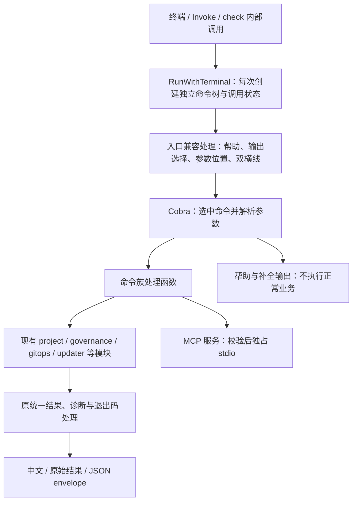

# YSS CLI Cobra 命令层设计

日期：2026-10-18。状态：用户已回复“审阅通过”；设计及实施计划已确认，用户已调用 executing-plans 授权实施；当前处于实施验证。

源码基线：`c10acc98f1d0ef9002a341bdc5cc822a4edc11dc`，代码版本 `2.4.0`。本设计针对 `/Users/zhudaoming/yss-cli`，不修改模板仓的生命周期规则、批准合同或固定来源。

## 1. 问题与目标

当前 CLI 已有统一结果输出、帮助元数据、离线文档生成、治理校验与安全事务。命令入口仍同时维护手写参数解析、参数范围判定和集中式执行分发，新增命令时需要同步这些位置。目标是把通用命令基础能力交给 Cobra，降低维护成本，并增加基础 Shell 补全；现有业务校验继续在原模块执行。

本次不承诺启动速度、内存或业务执行速度改善，也不重写 Bundle、治理核心、事务、脚手架生成器或程序安装器。不引入 Viper、simplecobra、插件系统、配置中心或新的发布门禁。

研究事实与取舍分别记录：当前结构和框架行为见文末固定源码及研究包；本文件中的结构、批次与验收要求已获用户审阅通过，尚未证明已实现。

## 2. 已确认的设计决定

| 澄清项 | 决定 |
| --- | --- |
| Q1 目标优先级 | 维护成本优先，兼顾使用体验；性能收益不列为承诺 |
| Q2 选型范围 | 对照继续自研、仅引入 pflag、引入 Cobra 后定案 |
| Q3 兼容底线 | 保持公开命令、参数、JSON、退出码和 MCP 合同；异常输入明确登记 |
| Q4 选型结果 | 采用 Cobra，复用现有业务校验、事务及输出 |
| Q5 设计范围 | 覆盖全部现有命令的目标结构和分批迁移路线 |
| Q6 补全范围 | 命令、参数、静态枚举、文件与目录路径；Bash、Zsh、Fish、PowerShell |
| Q7 对外交付 | 分批开发、验证，全部迁移完成后形成统一切换的发行候选 |
| Q8 重复参数 | 保留各命令当前的拒绝或后值覆盖规则 |
| Q9 新增语法 | 支持 `--` 结束选项；后续位置参数仍接受原数量、路径和权限校验 |
| Q10 测试断言库 | 已确认首期沿用标准库；复杂断言出现实际维护负担时再评估局部引入 Testify，见第 8.1 节 |

选型比较：仅引入 pflag 能替换解析，但命令组织、帮助和补全仍需自行维护；继续自研可以改善局部结构，但仍承担通用 CLI 能力维护。Cobra 覆盖本次所需的命令树、局部与继承参数、帮助和补全，且可定制输出，因此采用 Cobra。

设计依赖基线为 Cobra `v1.10.2`（`88b30ab89da2d0d0abb153818746c5a2d30eccec`）和其声明的 pflag `v1.0.9`（`10438578954bba2527fe5cae3684d4532b064bbe`）。实施时精确锁定版本并审查 `go.mod/go.sum`，不使用无版本的自动升级，不因此降级现有依赖。上述版本已查阅源码，尚未在本仓执行依赖安装或构建。

## 3. 命令层结构

继续以 `Run`、`RunWithTerminal` 和 `Invoke` 作为调用接口，不向其他业务包暴露 Cobra 类型。命令构造器、参数值、重复次数和执行结果全部属于当前调用；禁止使用全局可变的 `*cobra.Command`、FlagSet 或参数变量。

CLI 业务处理函数继续返回结果、Profile 与错误，由入口统一输出；函数内部不调用 `os.Exit`。取消上下文通过 `ExecuteContext` 和现有函数参数传递。MCP、补全和帮助按各自协议输出，不能被普通业务 envelope 包装。

这同时覆盖 MCP 的多次 `Invoke` 和 `check.runCheck` 递归调用 `RunWithTerminal`。新建命令树只解决命令状态隔离，不据此宣称全部业务模块支持任意并发。

### 3.1 定义与执行在同一命令树收敛

在 `internal/cli` 内按现有命令族组织构造函数，用普通 Go 函数创建 Cobra 命令并绑定现有处理逻辑。不建立新的命令 DSL、独立注册中心或每个叶子一个模板文件。

命令路径、局部参数、参数说明、静态候选值和执行入口在同一声明位置维护。共用参数使用小型注册函数复用；现有教程、前置条件、诊断和安全提示作为叙述内容保留，不再独立决定命令是否存在或接受哪些参数。

治理层的 `ArgumentKeys`、按 `--kind` 选择的规则以及业务输入校验继续拥有领域约束。CLI 可消费这些已有声明，但不能自行生成另一套治理授权政策。

### 3.2 参数适配的边界

Cobra 负责通用参数解析，命令适配把实际提供的参数交给现有处理函数。第一轮迁移保留 `options` 与 `map[string]string` 这种内部交接形式，避免同时重构全部业务函数。

只传递实际出现的参数，保留“未提供”“显式空值”“显式 false”的区别。不能遍历全部默认值后灌入业务 map；现有代码会根据参数是否出现选择正式合同、资源范围和兼容路径。

共享的参数值适配只承担严格布尔值、出现次数与必要的格式错误映射。布尔值继续只接受小写 `true/false`，不能直接继承 pflag 对其他布尔拼写的接受范围。重复次数按当前命令规则处理，不能把原拒绝改为覆盖，也不能把原覆盖擅自改为拒绝。

## 4. 对外兼容合同

| 场景 | 设计要求 |
| --- | --- |
| 命令与参数 | 全部现有公开路径、默认动作、兼容参数和已使用的参数位置保留 |
| 参数作用域 | `--root` 等只属于相应项目命令；程序升级不能因继承参数而接受项目参数 |
| 长参数 | 保留 `--key value` 和 `--key=value`；缺值、非法值及未知参数仍进入现有参数错误类别 |
| 短参数 | 保留独立的 `-h`、`-V`；不自动增加 `-v` 或组合短参数 |
| 帮助 | `yss`、`yss help ...`、`--help` 保持离线中文帮助；帮助优先于执行参数校验，但命令路径仍须合法 |
| 版本 | `version`、`--version`、`-V` 继续走现有版本结果和 JSON 协议，不直接使用 Cobra 默认版本文本 |
| 呈现 | 终端、管道、重定向、`--human`、`--json`、`--diagnostics` 继承当前条件和输出通道 |
| 显式 false | `--human=false --json` 等合法组合继续成立；不能用“参数出现即互斥”替代按值校验 |
| JSON | 成功、业务失败和参数解析失败都保留现有 envelope 字段、领域 result、错误类别和退出码；`command` 继续取原顶层命令名 |
| 写入与联网 | 原计划、确认远端、固定来源、身份、摘要、冲突、路径和事务保护全部继续执行 |
| MCP | 工具白名单、参数 schema、固定项目根和只读范围不扩大；不从命令树自动暴露工具 |

帮助与错误说明可以在审阅后改进表达和排版，但不能因迁移丢失原因、处理动作、示例或退出码。旧解析器和 Cobra 的内部报错文案不要求逐字一致；转换后的稳定机器字段和错误类别必须一致。迁移发现的其他异常输入差异逐项登记，不默认为扩大语法或放松校验的授权。

### 4.1 入口兼容处理

复用并收敛当前 `helpRequest` 与输出预扫描，使用同一命令树的参数声明识别命令路径。它仅承担三项兼容职责：在解析失败时确定输出形式；在合法命令路径上保留帮助优先；将命令前后的现有参数位置规范化为 Cobra 可处理的输入。

规范化不改变参数的相对先后顺序，不猜未知参数的类型，不补默认值，也不访问项目或执行处理函数。参数数量、类型、合法作用域和业务值仍由 Cobra 与现有业务校验负责。不得保留一套并行的完整参数解析器。

设置 `SilenceErrors` 和 `SilenceUsage`，将框架解析与位置参数错误转换为现有 `ARGUMENT`、退出码 `2`；继续复用中文诊断和未知名称提示的适用信息，不依赖识别英文错误字符串来判定业务失败。

Cobra 隐藏补全请求需要优先识别：其尾部 `--help`、`--json` 可能只是待补全词，不能被入口当作真实帮助或输出开关。此模式只运行补全协议。

### 4.2 双横线语法

`--` 之前解析选项；其后全部内容作为位置参数，不再激活帮助、版本或呈现开关。例如，`yss check --root <目录> -- -example.yaml` 可把短横线开头的文件交给原路径校验。

它不新增位置参数配额：不接受位置参数的命令仍拒绝，不把后续词自动提升为新子命令，也不绕过符号链接、目录范围或权限校验。MCP 现有参数到 argv 的限制继续保留，不借此次 CLI 语法扩展改变工具边界。

## 5. 帮助、文档与补全

根帮助保留项目、资源、Git、程序、治理、工具的现有导航及生命周期说明。命令帮助保留前置条件、最小示例、参数条件、预期结果、下一步和常见错误。教程与错误帮助继续由原内容提供。

`HelpGuide` 继续作为 `tools/helpdocs` 的入口，改为从最终命令树读取路径和参数。沿用现有生成链更新 `docs/cli-help.md` 及既有嵌入帮助块；不手改生成区域，不额外建立第二套文档生成器。

新增 `yss completion bash|zsh|fish|powershell`，把脚本写到 stdout；不安装脚本，不编辑用户 Shell 配置。静态补全来自命令树、现有枚举以及按已提供 `--kind` 可确定的参数规则。只有路径类参数和相应位置参数启用文件或目录补全，其余参数默认不回退到文件名。

补全过程不读取 Ticket、阶段实例或项目业务资产，不访问网络，不进行身份探测、治理校验、写入或 MCP 服务启动。Shell 对路径的本地枚举不等于业务处理函数读取项目。

帮助、补全脚本、隐藏补全协议以及已启动的 MCP 服务使用各自输出格式，不附加业务 envelope、中文成功摘要或日志。普通命令保持原结果格式。

## 6. 范围与文件影响

| 位置 | 设计影响 |
| --- | --- |
| `go.mod`、`go.sum` | 精确登记 Cobra、pflag 及实际解析出的依赖变化 |
| `internal/cli/cli.go` | 保留公共入口与输出语义；收敛调用状态；最终删除手写 `parse` 和顶层集中分发 |
| `internal/cli/commands.go` 与新增根构造文件 | 改为命令树装配及小型参数适配；移除重复的 CLI 命令注册和机械白名单 |
| 现有 `*_commands.go`、`scaffold.go`、`bundle.go` 等 | 按原功能族绑定 Cobra 入口；必要时把原集中分发中的逻辑原样抽入同族处理函数 |
| `help.go`、`help_topics.go`、`documentation.go` | 帮助和文档读取命令树；保留教程、安全说明与中文呈现 |
| `mcp.go`、`check.go` | 保留现有调用接口，覆盖连续调用和递归调用；不另建执行引擎 |
| `tools/helpdocs`、`docs/cli-help.md`、兼容说明 | 消费原接口并更新必要生成结果和新增补全、双横线语法说明 |
| Go 测试与既有 CI | 补充小型命令层回归；复用现有构建、静态检查、生成链和冒烟 |

`project`、`governance`、`transaction`、`gitops`、`updater`、`scaffold`、`bundle` 等包继续持有业务语义。若实施发现必须修改这些规则才能接入 Cobra，应先报告具体影响并修订设计，不能顺手改变安全或授权规则。

迁移清单以现有帮助声明、执行分发和消费者共同核对。必须包含帮助中以位置动作表示的三级路径，如 `git branch start`、`git hooks install`、`git release tag`、`git policy set`，以及父命令的默认查询和读写双模式，不能只复制帮助表的两级名称。

## 7. 分批迁移路线

| 批次 | 范围与完成条件 |
| --- | --- |
| 1 入口与定义 | 固定命令和参数清单、兼容案例；接入根构造、调用状态、`version/capabilities`、帮助和输出错误适配 |
| 2 只读调用 | 迁移已确认的只读查询、校验、MCP 和 `check` 内部调用；验证连续调用、递归调用、取消及输出通道 |
| 3 本地写入 | 迁移项目与资源、脚手架、Profile、阅读视图、阶段/目标、运行记录、归档、HTML 导出和本地 Ticket 链接等写入模式 |
| 4 高影响操作 | 迁移 Git 写入与远端推送、Tracker 远端同步、在线/离线程序升级及其恢复回退；继续使用原保存计划和确认保护 |
| 5 收敛与候选 | 接入完整静态补全和生成文档；移除旧解析/分发路径，完成全量命令覆盖检查后形成统一候选 |

批次按实际调用模式分类，不能把一个命令族整体视为只读：例如 `lifecycle target`、`reading render`、`trace --html`、`bundle export` 与相应查询的副作用不同。

开发期间可使用短期适配连接尚未迁移的函数；同一条命令每次只由一个解析入口负责，不在 Cobra 报错后自动降级旧解析器，也不增加对用户可见的旧版开关。中间批次不对外发布；最终候选必须删除旧入口。最终路由直接到命令族函数，不让所有 Cobra 叶子继续回调旧顶层 `execute`。

## 8. 必要验收

新测试通过现有 `RunWithTerminal`、`Invoke` 等调用接口验证外部行为，用小型表驱动断言、临时目录和内联数据；不恢复录制回放、差分预言机、长跑恢复或性能测试体系。

| 行为 | 必须证明的结果 |
| --- | --- |
| 清单覆盖 | 每个现有公开路径、默认动作及三级动作均能定位到唯一 Cobra 入口；业务命令未遗漏 |
| 解析与范围 | 两种长参数形式、命令前后参数、严格布尔、未提供/false、每命令重复规则、未知与缺值；项目参数不能进入程序升级 |
| 帮助与双横线 | 帮助优先且不读取项目；`--` 后的 `--help/--json` 仅是位置参数；无位置参数配额的命令仍拒绝 |
| 输出合同 | 成功、参数失败、业务失败和携带事务回执的失败保留机器字段、退出码与通道；终端和管道行为继续成立 |
| 调用隔离 | 一次带参数调用不污染下一次无参数调用；MCP 连续调用、`check` 嵌套调用和直接调用的结果一致；取消继续传播 |
| 副作用边界 | 帮助与补全不执行业务；MCP 白名单和固定根不变；写入命令仍拒绝缺计划、输入漂移、缺远端确认等原有负例 |
| 帮助与补全 | 原文档生成入口可用；四种补全脚本均可生成；静态命令、参数、枚举及路径类型与实际树一致；补全尾词不触发帮助或输出开关 |

批次内只运行命中行为的轻量测试。最终候选复用仓库既有要求：准备固定 Bundle 后构建、格式/静态检查、全量 Go 测试（5 分钟上限）、构建后既有黑盒冒烟，以及 `tools/artifacts.mjs check --scope all` 的当前完整生成链。已有检查覆盖时不再增加一套同义检查；有 Bundle 时无需为同一候选重复执行一遍无 Bundle 全量测试。

四种脚本生成通过不等于四种 Shell 实际运行均通过。只对已执行的 Shell 语法和运行场景记录通过，其余标为未执行；不安装额外 Shell 或新建发布资格体系来填补本轮设计证据。

完成标准还包括：新增一个同族普通命令不再同时修改独立帮助注册、CLI 参数白名单和顶层分发三处；领域约束的登记仍按原模块要求执行。此项在实施后用实际代码结构核验，不预先承诺删除行数或节省比例。

### 8.1 Testify 选型补充（已确认）

用户已确认首期沿用标准库测试，不引入 Testify。当前 `go.mod` 未声明该依赖，`internal` 下 22 个 Go 测试文件未导入 Testify，已有 `testing`、表驱动测试、`t.Helper`、临时目录和 CLI 调用辅助。这些工具足以编写本设计所需的退出码、协议字段、错误及副作用检查；现有用例不等于已经覆盖全部 Cobra 迁移场景，实施时仍须补充命中的兼容回归。

Testify 的 `assert/require` 与 `testing.T`、`go test` 集成，可以简化重复断言并改善失败信息；是否降低本仓维护成本尚未测量。首期复用现有辅助，不为改写简单判断增加依赖，也不批量重写无关旧测试。

若实施中出现明显的复杂结构断言或重复诊断负担，再根据真实案例评估局部引入；本次不预建包装层或预装依赖。未来若选择 Testify，范围限于新增或实质修改用例中的 `assert/require`：前者检查可独立报告的结果，后者检查解析、初始化等前置条件。`require` 只在当前测试的 goroutine 调用，工作 goroutine 返回结果后再由测试主体断言；不因此引入 `suite`、`mock`、额外运行器、lint 体系或自研通用断言 DSL。

保留必要字段与类型、错误码、退出码、stdout/stderr、调用隔离和写入保护的定向断言；不以宽松 JSON 相等或整体文本快照替代这些合同。测试范围、5 分钟上限和现有 CI 不因这项决定而改变。

本项一手依据见 [Testify v1.12.1 固定版本官方说明](https://github.com/stretchr/testify/blob/959dbdacf1533e155162811ea90c90117a420463/README.md) 和当前基线测试。补充研究保存在 `maintenance:research/2026-10-18-yss-cli-cobra/testify-supplement/`，保留确认前的建议与调查事实；当前 Q10 决定由本设计登记，不改写原研究包或历史验证记录。本轮未安装依赖或重写测试。

补充包结构校验实际退出码为 `0`，包含 2 项技术 Claim。补充目录下 `source-manifest.json` 的 SHA-256 为 `8b4f3eaf044836b86fa7e4d50f224505ecb8d65d9ae5d256568ff46307c5fafd`；`verification/verification.json` 的 SHA-256 为 `892780c19a494a1236513929db130e78527eaaae3aca47de6a9db809e843985d`。后者同时绑定研究简报、台账及实际校验日志；结构通过不代表 Testify 已在本仓测试通过。

## 9. 风险、恢复与后续工作

主要风险是框架默认行为改变接口：帮助发生在参数解析之后、布尔拼写更宽、参数存在性丢失、命令树状态复用、默认版本输出、嵌套动作遗漏及补全词被普通预扫描误读。上述风险分别由入口兼容处理、严格参数适配、每次独立构造、统一输出和对应小型案例覆盖。

本次不改变保存计划、实例元数据和事务存储格式。对外切换前所有中间批次只用于开发验证。候选失败时先停止形成发行候选；代码回退按已验证基线和实际变更提交处理，保留用户工作，不自动 reset、清理或覆盖。正式发行、已安装程序的升级/回退及旧计划消费资格继续遵循现有工具合同，不能仅因命令层可编译就宣布安全。

设计审阅已通过；下一步见[实施计划](../plans/2026-10-18-cobra-command-layer.md)，其中细化命令清单、每批文件范围、必要案例和删除旧入口的条件。用户已调用 executing-plans 执行实施计划；实际验证以迁移记录和仓外证据为准，提交、推送和发布仍未授权。

## 10. 证据与限制

可复核的一手来源：

- [YSS CLI 入口、解析与输出](https://github.com/iloveZzz/yss-cli/blob/c10acc98f1d0ef9002a341bdc5cc822a4edc11dc/internal/cli/cli.go)、[命令元数据](https://github.com/iloveZzz/yss-cli/blob/c10acc98f1d0ef9002a341bdc5cc822a4edc11dc/internal/cli/commands.go)。
- [现有呈现兼容合同](https://github.com/iloveZzz/yss-cli/blob/c10acc98f1d0ef9002a341bdc5cc822a4edc11dc/docs/compatibility.md)、[MCP 入口](https://github.com/iloveZzz/yss-cli/blob/c10acc98f1d0ef9002a341bdc5cc822a4edc11dc/internal/cli/mcp.go)、[check 内部调用](https://github.com/iloveZzz/yss-cli/blob/c10acc98f1d0ef9002a341bdc5cc822a4edc11dc/internal/cli/check.go)。
- [保存计划与应用前校验](https://github.com/iloveZzz/yss-cli/blob/c10acc98f1d0ef9002a341bdc5cc822a4edc11dc/internal/project/plan.go)、[现有轻量测试约束](https://github.com/iloveZzz/yss-cli/blob/c10acc98f1d0ef9002a341bdc5cc822a4edc11dc/AGENTS.md)。
- [Cobra 固定版本命令实现](https://github.com/spf13/cobra/blob/88b30ab89da2d0d0abb153818746c5a2d30eccec/command.go)、[参数组实现](https://github.com/spf13/cobra/blob/88b30ab89da2d0d0abb153818746c5a2d30eccec/flag_groups.go)、[补全实现](https://github.com/spf13/cobra/blob/88b30ab89da2d0d0abb153818746c5a2d30eccec/completions.go)、[依赖声明](https://github.com/spf13/cobra/blob/88b30ab89da2d0d0abb153818746c5a2d30eccec/go.mod)。
- [pflag 固定版本布尔解析](https://github.com/spf13/pflag/blob/10438578954bba2527fe5cae3684d4532b064bbe/bool.go)。

研究附件由发起模板工作区保存在仓外 `maintenance:research/2026-10-18-yss-cli-cobra/`，包含 `cobra-command-layer-research-brief.md`、`cobra-command-layer-evidence.yaml`、原字节快照与摘要清单。它是设计依据，不是 CLI 的运行或构建依赖，也不替代本设计的用户审阅。

本设计消费的研究字节绑定如下，后续修改附件应同步核对引用：

| 附件 | SHA-256 |
| --- | --- |
| `cobra-command-layer-research-brief.md` | `a51691f0de02c8b0b8675893bf6f81960e4eeb808c9ae3e83f4fe20188d816d3` |
| `cobra-command-layer-evidence.yaml` | `fdd8ca7da95978cc3613ae32ae8588714c2d9b2af2affb34017ce7d262857a75` |
| `source-manifest.json` | `35ffb4774ce7cb8fbaeaa989b989e1bdb2ea3187d1146ff36724ac24179bc461` |
| `verification/verification.json` | `7a8d97b997989555f65a162d3030faa2e8c36cc8dcd49b59b6a8cd1f8015a94f` |

研究包结构校验实际退出码为 `0`，覆盖 6 项源码 Claim；30 份来源快照的摘要已核对。该结果不表示 Cobra 接入或行为回归已经通过。

本轮只核对源码与公开材料并编写文档；未安装 Cobra、未改变生产代码、未运行 Go 测试或性能测量，未确认全部消费者的实际参数使用样本。实施第一批必须补齐当前消费者清单；出现未登记的真实消费者行为差异时先报告，不自行扩大兼容破坏范围。
