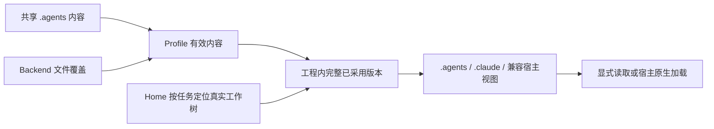

# Home Repo 多项目协调与跨宿主 Skills 设计

日期：2026-11-15。状态：核心实现、多工程验证、最终构建与独立评审已完成；Claude、Pi、DSH 的运行验证仍受本机登录/订阅条件阻塞。逐项状态见配套计划，不代表五宿主全部验收。

## 1. 结论与范围

采用“共享源统一维护、工程保存已采用版本、Home 按任务选择、宿主分别适配”。Home 是产品级工作入口，可以由现有 Spec 仓承担；Backend、Web、Mobile、共享组件仍保留自己的 Git 历史、规则、代码和技能版本。无需新增 Home Profile 或中央技能仓库服务。

本次交付是一项跨 Template / CLI 的完整能力：补足多项目工作方法、准确描述五个宿主的加载边界，并修复工程 Profile 的 Claude 技能分发缺口。文档与 Bundle 必须使用同一套路径和版本语义，因此采用一份实施计划。

本轮不会修改真实业务仓、用户全局配置或已安装的 CLI，不包含提交、推送、部署、正式发行。上一轮已完成的 Git / Skills 可移植性改动属于本轮基线，不能回退重做。

### 全局约束

- 保持 Profile 为 `spec / backend / frontend`，安装类型为 `project / skills`；默认技能数量分别为 `17 / 42 / 13`。
- 一个 YSS 安装根只使用一个 Profile；`skills` 安装也不支持把多个 Profile 合并进同一收据。
- 不新增命令、Profile、收据 schema、宿主注册表、常驻同步服务或跨宿主进程调度器；不新增运行时依赖。
- 共享技能源保留在 `.agents/skills`；Backend 保留文件级覆盖；工程内保存完整已采用载荷及合法收据。
- 不改技能名称、不把工程技能批量搬入 Home 或用户全局目录；不通过删除收据、锁或事务绕过保护。
- 保留现有 `.workbuddy` 普通文件副本；新增宿主视图只能来自当前 Profile 的有效 `.agents` 内容，不增加新的手工内容源。
- 保留未知文件、用户定制、摘要、安装所有权、事务及并发保护；远端与本地路径必须在实际执行环境解析。
- 不新增持久测试套件、包装脚本或检查资产；必要探针放在仓库外临时目录，交付记录实际证据及未验证范围。

## 2. 当前事实与新增缺口

实施入口：

- CLI：`/Users/zhudaoming/.codex/worktrees/home-git-skills-cli/yss-cli`，HEAD `bcef09abdd57bf7806c3965526246186031a6887`。
- Template：`/Users/zhudaoming/.codex/worktrees/home-git-skills-template/yss-spec-project-template`，HEAD `b8a8ceb81adcd75efc4f644e544f7e158080bb27`。
- 两者有上一轮未提交改动：CLI 3 个文件、Template 17 个文件。执行时重新核实实际状态，不能用 HEAD 代替工作树输入快照。

已有能力：三 Profile、安装资源闭包、所有权与事务保护、Git 载荷保存指引、Home 导航提示。上一轮已在 Codex 中验证从合成 Home **显式读取** Backend / Frontend 工作树技能和资源；这不是原生技能注册证明。

已确认缺口：

1. Backend / Frontend 清单排除 `.claude/skills`。仅放行清单不够：CLI 的共享 kernel 不包含该路径，根 Claude 链接又在 Profile 覆盖前展开，可能把 Spec 的 `implement`、`to-tickets` 等内容当成 Backend 版本。
2. 当前宿主目录识别包含 `.agents/.claude/.codex/.cursor/.pi/.workbuddy`，不含 `.codebuddy`；WorkBuddy 官方代码开发配置说明使用 `.codebuddy/skills`，现有 `.workbuddy` 是否被本机客户端读取仍需实测。
3. Frontend 不安装 `implement`，也没有其叶子资源声明。所有 Profile 都需要的协调与宿主说明应放入默认安装的 `setup-yss-harness`，不能给 Frontend 留下悬空引用。
4. 已有协调说明需要补齐：同仓多工程、同名技能来源、输入版本变化、任务恢复、运行资源占用、部分完成与跨仓发布顺序。

## 3. Home、Git 与工程身份

### 推荐布局

```text
workspace/
  product-home/          # spec；业务资料、产品导航、整体协调
  customer-api/          # backend；独立 Git 仓和安装根
  order-api/             # backend；另一个独立工程
  web/                   # frontend
  mobile/                # frontend
  shared-ui/             # 按实际职责选择已有 Profile，不能因在地图中就强制安装
```

工程应加入其所属 Git 仓。Home 的 Git 保存导航、共享产品资料和自身技能，不跟踪外部工程代码副本。Git submodule 不是必需条件；已有子模块按其真实边界操作，不作为普通子目录覆盖。

同一 Git 仓可以包含多个工程。推荐 `repo/spec`、`repo/services/api`、`repo/apps/web` 分别作为不重叠的安装根，Git 根只作容器。每个工程由“仓库身份 + 仓内子路径”唯一定位，不能只用 `backend` 或目录 basename 识别。已有 Home 根包含子工程的布局先核实各安装根和受管文件范围，不能据此宣传任意父子安装安全或自动重构目录。

现有 CLI 没有父子安装根之间的所有权仲裁，锁也各属于自己的安装根；Git/submodule 边界检查不等于普通子目录隔离。因此父根与子根不得管理同一物理文件；同仓同步涉及共享路径时串行执行。本轮通过布局建议和检查受管路径解决，不增加跨根锁或扫描服务。

稳定关系继续放在已有 `REPOSITORIES.md` 或 README 的仓库地图中：工程 ID、职责、经核实的 remote、仓内路径、Spec / API / Skills 入口和实际依赖。路径尽量相对，不登记个人绝对路径、当前分支、临时 worktree、执行进度或凭据；没有 remote 就记录事实，不能编造地址。

当前任务才记录实际 clone / worktree 的绝对路径、允许修改范围、输入版本和责任人。模型访问不到外部路径时，应报告该环境缺少挂载或权限，不能悄悄切回主工作树的同名目录。

## 4. 多项目任务如何推进

### 责任与输入

Home 负责明确用户目标、选择受影响工程、安排依赖、汇总结果；Spec 负责业务规则与原型；API 契约由实际 Backend 或独立契约工程维护；实现、构建和测试由各工程负责。Home 引用权威资料，不维护第二份容易漂移的 OpenAPI 或代码真相。

先检查真实调用关系再扩展范围。地图中列有 Web 和 Mobile，不意味着每次后端修改都要改两个客户端。任务输入须包含相关提交和工作树差异，必要时记录未跟踪输入的摘要；`HEAD` 不能代表尚未提交的 Spec / API / Skills。

进入工程前读其适用规则及实际工作树里的技能。目标工程技能优先用于工程任务，Home 技能用于产品协调；这是任务选择规则，不宣称覆盖宿主的系统、组织或个人指令优先级。同名技能使用完整路径和用途消歧，不靠改名或静默覆盖。

### 推进、并行与反馈

依赖顺序是“业务目标 → 受影响契约 → 各工程实现 → 必要集成结果”，不是强制所有工作串行。契约明确后可并行；尚未明确时客户端可先做布局或 mock，并明确标记使用模拟数据。共享 OpenAPI、生成客户端、根锁文件或共享组件同一时刻只有一个修改责任人。

宿主支持子 Agent 时，每份委派包含目标工程、路径边界、输入版本、技能来源、交付要求和共享资源责任；不支持时按相同边界串行。无需让 Codex 自动启动 Claude、Pi 或 DSH 来构建跨宿主调度系统。

子任务返回实际改动、输入版本、运行过的检查、失败与后续依赖。只完成 Backend 或只通过 mock，整体任务仍是部分完成。发现业务歧义回到 Spec；发现契约不一致回到契约拥有者；不在多个工程中各自猜测规则。

### 变化、恢复与运行环境

输入由 A 变成 B 后，保留“结果基于 A”的事实，仅重做受影响部分；技能修改同样需要重新核实已采用版本和会话缓存。长任务中断后，复用当前聊天或已有实施文档中的简短记录：目标、工程/worktree、输入、已做事项、证据、剩余依赖、下一步。恢复时重新核实工作树与占用状态，不凭旧的“完成”标签继续执行。

Git worktree 不隔离端口、数据库、输出目录、运行中的二进制或浏览器配置。并行任务应记录这些资源的实际归属，使用独立临时资源；清理前验证身份，只清理本任务创建的对象。代码存在于某 worktree 不证明正在测试的服务也来自那里。

只有用户任务包含发布时，才补充兼容窗口、生产者/消费者顺序、各仓负责人和失败处理。多个 Git 提交不是原子发布；不能因一个仓失败自动 reset 其他仓或回滚外部系统。

## 5. Skills 的内容、分发与执行



技能包必须包括 `SKILL.md` 及实际引用的 references、scripts、templates 等资源。资源相对路径以技能目录为基准，运行命令以目标工程为 cwd；两者不能混用。读取外部技能不意味着同时加载该工程的 AGENTS，也不意味着宿主自动取得 MCP、浏览器、命令或写权限。

工程可以固定不同的技能版本。普通任务先使用工程已采用版本，不自动同步全局最新。用户要求升级时使用现有 `sync` / `skills ensure` 流程与冲突保护；项目收据记录载荷来源，任务记录当前实际使用的技能路径和必要内容摘要。

### Claude 视图的最小实现

在 `src/bundle/build.rs` 的 `build()` 中，完成共享内容选择及 `_specialist` / Profile 覆盖、构建有效 `files` 与 `objects` 后，生成 `.claude/skills/<name>/<resource>`，再构建 installation 视图。

- 来源仅为该 Profile 已选中的 `.agents/skills` 文件；复制完整资源路径、descriptor，复用已有对象，不重新读取源码文件或生成另一套内容。
- 目标必须被该 Profile 清单放行；ownership 与 render 使用目标路径策略。渲染标志应与对应 canonical 文件一致，清单必须明确列出有占位符的宿主路径。
- 已有相同视图且 descriptor、ownership、render 一致时复用；冲突或没有 canonical 对应来源的视图拒绝构建，不能静默覆盖。
- Spec 根现有 `.claude` 链接继续按原有安全规则读取；不把 `.claude` 加进共享 kernel，不新增嵌套 Profile 软链接。
- Backend / Frontend 放行精确 `.claude/skills` 子树，保留其它宿主配置排除；选择仍由已有技能闭包控制，Frontend 不因此变成完整 Backend 技能集。
- 收据、archive 与输出格式不变。新文件通过现有安装事务加入；旧项目同路径文件冲突时保留并报错。

首次增加宿主视图还需一个局部保护：若工程 canonical 文件的本地修改会被本次同步保留，而新视图内容与该文件不同，整次操作返回 `CONFLICT`，不产生半套新入口。检查复用已有计划中的操作、保留路径与文件快照，不重复读文件，不绕过现有三方冲突规则。未修改的旧文件正常升级；本地删除但被保留的 canonical 同样不能配上一个新视图。

这不是工程内副本的持续同步器。已安装的不同宿主文件可能被用户分别修改，普通任务仍需核对实际采用来源；处理冲突时保留定制并明确协调版本，不能自动复制用户内容进 Bundle 或伪造来源收据。

### WorkBuddy 的有界决策

实施时先在合成项目中分别测试仅 `.workbuddy`、仅 `.codebuddy`、两者同时存在三种情况，使用不同随机标记确认实际来源。不得只以模型声称“已加载”判定成功。

| 实测结果 | 本轮唯一行动 |
|---|---|
| 当前 `.workbuddy` 可原生发现并正确读取资源 | 保留现有分发，不新增 `.codebuddy`；记录确切客户端版本及证据 |
| `.workbuddy` 不可发现，`.codebuddy` 可发现 | 使用上述同一派生逻辑增加 `.codebuddy/skills`，补 `skill_for_path` 与限定清单及 renderPaths；保留旧 `.workbuddy` 兼容载荷 |
| 两者都可发现 | 继续只分发现有 `.workbuddy`，避免新增重复注册；记录实际来源优先级 |
| 两者都失败、客户端不可用或缺少可核验证据 | 本轮保持已有载荷，仅提供已验证的显式读取方式；原生支持标记未验证/受阻，不宣称五宿主原生验收完成 |

只有第二行触发代码分支，不引入用户开关或可配置宿主框架。`.codebuddy` 若启用，仅生成普通 Bundle 载荷，不接受新的源码软链接；不开放整个 `.codebuddy` 配置目录。验证失败意味着对应支持项未完成，不能用文档措辞消除缺口。

## 6. 五宿主适配边界

以下是调研结论与验证入口，不是统一的原生支持承诺。每个宿主分别记录四项证据：**载荷完整、原生目录可发现、使用了正确工作树/版本、必需工具可用**；显式读取是另一条可验证路径。

| 宿主与本机版本 | 本轮采用方式 | 必须注意 |
|---|---|---|
| Codex `0.167.2` | 工程 `.agents/skills`；Home 跨仓任务显式读取目标技能 | `--add-dir` 是可写目录授权参数，不能当作任意技能根注册开关；已有跨仓探针仅证明读取 |
| Claude Code `2.1.319` | `.claude/skills`；需要时以 `--add-dir` 加入真实工程 | 同名可能产生目录限定命令；必须读实际注册来源；新增目录不等于自动加载全部工程规则；不能继承主 checkout 的旧技能 |
| Pi `1.5.2` | 复用 `.agents`；跨仓使用明确 `--skill` 或已验证的 settings 路径 | 同名优先级与信任状态影响发现；精确子集用 `--no-skills --skill ...`，不新增 `.pi` 技能副本 |
| DeepSeek Harness `0.2.2-rc.3` | 复用 `.agents`；需要时按真实 preset 的 `customSkillDirs`，否则显式读取 | registry/provider/tool 必须启用；相对自定义路径基准不能猜；不把 Claude 扩展字段视为可执行能力 |
| WorkBuddy App `5.11.3` | 按上一节实机分支；外部工程可访问时显式读取 | 本机未发现已核实的 headless CLI；使用 GUI 真实技能列表/调用证据，不套用 CodeBuddy CLI 参数 |

Pi / DSH 不新增镜像目录。所有宿主都先检查真实版本、工程规则和工具能力；缺少子 Agent 可串行，缺少构建工具则记录未执行的检查，不能把技能已读取写成工程验证成功。动态重载按该宿主的实际行为执行，无法确认时用新会话重试。

## 7. 文档落点与维护闭包

通用说明集中到 `setup-yss-harness`：`project-portability.md` 讲工程身份、Git/输入边界；`repositories-template.md` 讲稳定地图；新增 `host-compatibility.md` 讲五宿主适配与证据层级。主 `SKILL.md` 只增加可按需读取的入口，不把完整矩阵放进常驻提示。

`implement/references/repository-scope.md` 补充委派、恢复、变更失效、运行资源及部分完成；Backend 继承这个共享叶子，保留专有实现规则。Frontend 使用 Setup 内的通用规则，不引用未安装的 Implement。

同时更新三份 `profile-skills.md` 与 Spec 教程；`profiles/_specialist` 教程按其裁剪内容增量修订，不能用根教程整体覆盖。Setup 的三份 WorkBuddy 副本、Implement 的 Spec/Backend WorkBuddy 有效副本同步更新；Backend 的 `setup-yss-harness`、`implement` 两个 `effectiveHash` 按有效树重算，保留 upstreamHash。新包内参考无需扩大技能成员。

CLI 的 `docs/skills-discovery.md` 记录新增视图、使用边界及本次实际证据；`docs/build-install.md` 仅在构建或采用方式发生变化时作相应小幅修订，不改历史发行标签。

## 8. 验收与失败边界

| 类别 | 必须证明的结果 |
|---|---|
| Bundle 内容 | 三 Profile × 两安装模式默认集合保持 17/42/13；Claude 与各自 canonical 的完整资源、descriptor、渲染结果一致；Backend 专有与覆盖内容不串成 Spec |
| 选择与升级 | 选装可用非默认技能后宿主视图同时出现；未知/已修改目标冲突时不覆盖；保留的本地 canonical 不与新宿主视图静默分叉；预览不写；同步后 doctor 正常，再次同步 unchanged；合法 clone 可继续使用 |
| 宿主来源 | 每个声称原生支持的宿主提供原生发现/调用证据；技能、reference、工程规则各有独立随机标记；同名主 checkout 与 worktree 不混读 |
| 多项目协作 | 合成 Home + 两 Backend + Web + Mobile，按实际依赖只改相关工程；共享契约单责任人；无子 Agent 能串行，缺工具/缺挂载保留未完成项 |
| 变化与恢复 | Spec/API 未提交变更被识别；恢复后重新核实输入与工作树；mock/部分工程完成不被汇报成整体集成完成；并行服务身份、端口与清理边界准确 |
| 布局边界 | 单仓多个不重叠安装根可使用；同一根不能切成多个 Profile；已有父子根与子模块先按实际受管范围验证，不能由普通子目录结果外推 |

只执行与本次修改相关的 Rust/Bundle、安装保护和代表性宿主验证，不因文档调整重建整个业务项目。macOS ARM64 是当前执行环境；Windows、远程容器、全部宿主版本不在本轮实测承诺内。

## 9. 依据与不确定性

- [Home Repo Pattern](https://www.aihero.dev/the-home-repo-pattern)：支持共享入口、仓库导航和保留仓库职责；本文的版本、事务与协调方案是结合 YSS 的设计判断，文章不提供跨宿主发现协议。
- [Agent Skills 格式](https://agentskills.io/specification)与[宿主实现指南](https://agentskills.io/client-implementation/adding-skills-support)：技能内容标准、按需加载与资源基准；目录、权限和扩展语义仍由宿主决定。
- [Codex Skills 官方说明](https://learn.chatgpt.com/docs/build-skills)：结合本地 `0.167.2` 帮助及此前显式读取探针使用。
- [Claude Code Skills](https://code.claude.com/docs/en/skills)：外部目录、同名技能和工作树行为；本文本机版本为 `2.1.319`，不能与 Claude Desktop 版本混用。
- [Pi 固定源码 resource-loader](https://github.com/earendil-works/pi/blob/b4afdddf44e059c67ccf5097e5317d913521b470/packages/coding-agent/src/core/resource-loader.ts)、[CLI 文档](https://github.com/earendil-works/pi/blob/b4afdddf44e059c67ccf5097e5317d913521b470/packages/coding-agent/docs/cli.md)：对应 `1.5.2` 的加载路径与显式技能参数。
- [DSH filesystem provider](https://github.com/deepseek-ai/deepseek-harness/blob/dsh-v0.2.2-rc.3/packages/skill/skill-filesystem/README.md)、[Skill 子系统](https://github.com/deepseek-ai/deepseek-harness/blob/dsh-v0.2.2-rc.3/docs/subsystems/skills.md)：对应本机预发布版本，后续版本需重新核实。
- [WorkBuddy 项目配置](https://www.workbuddy.cn/docs/workbuddy/From-Beginner-to-Expert-Guide/Function-Description/Project)、[用户配置](https://www.workbuddy.cn/docs/workbuddy/From-Beginner-to-Expert-Guide/Function-Description/Setting)：官方说明代码开发配置兼容 `.codebuddy`；当前 `.workbuddy` 的实际发现和外部目录加载仍待本机 GUI 验证。

现阶段已确认本机客户端入口及版本，尚未新发起 Claude/Pi/DSH/WorkBuddy 模型任务。本设计承诺明确实施路径、保护边界和验收条件，不把安装了客户端或存在技能文件作为运行成功证据。
